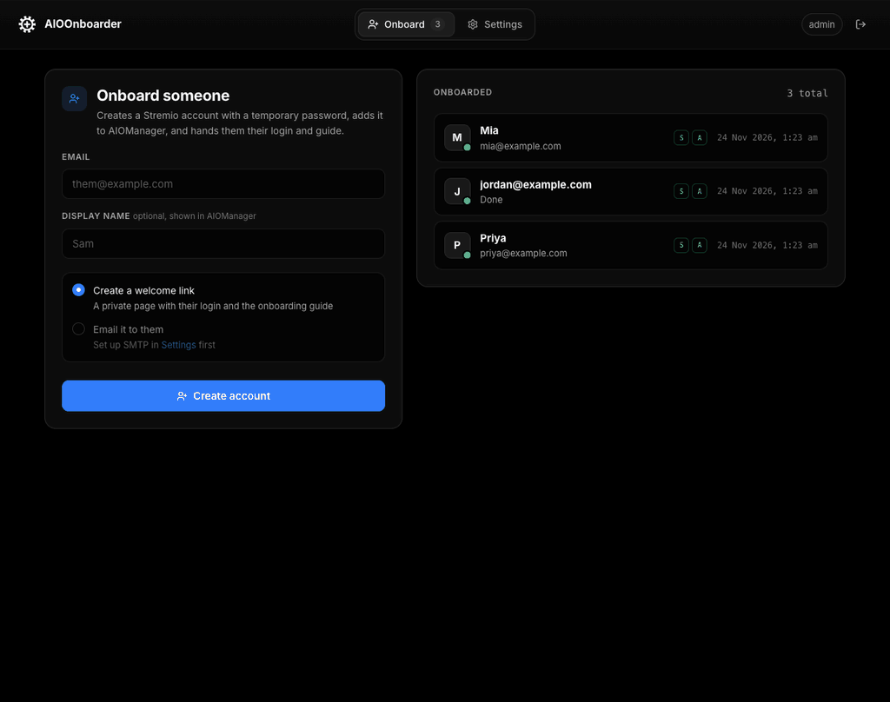
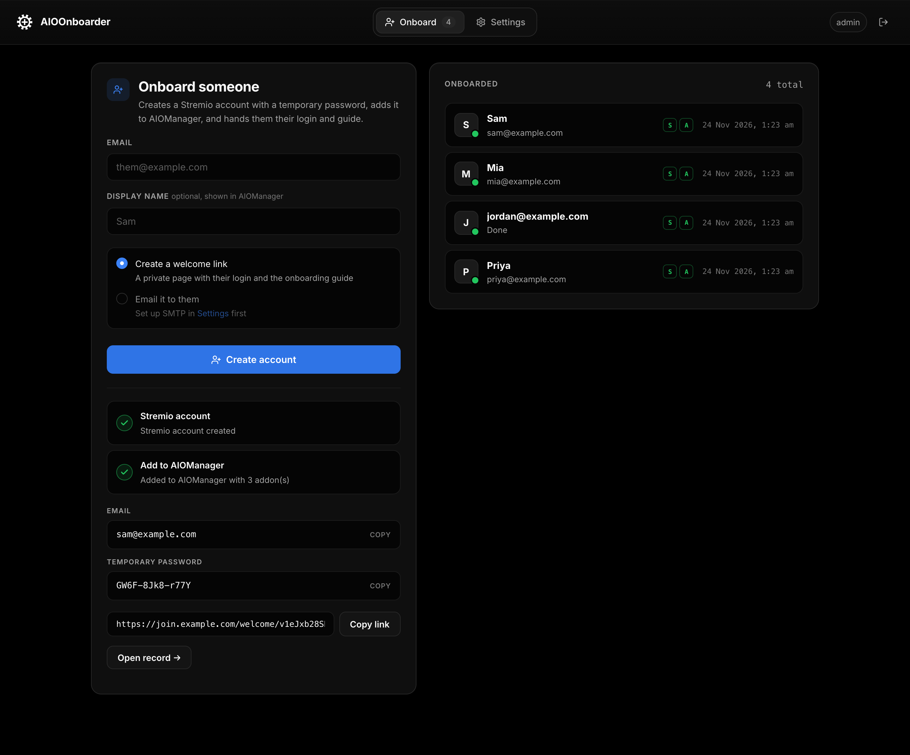
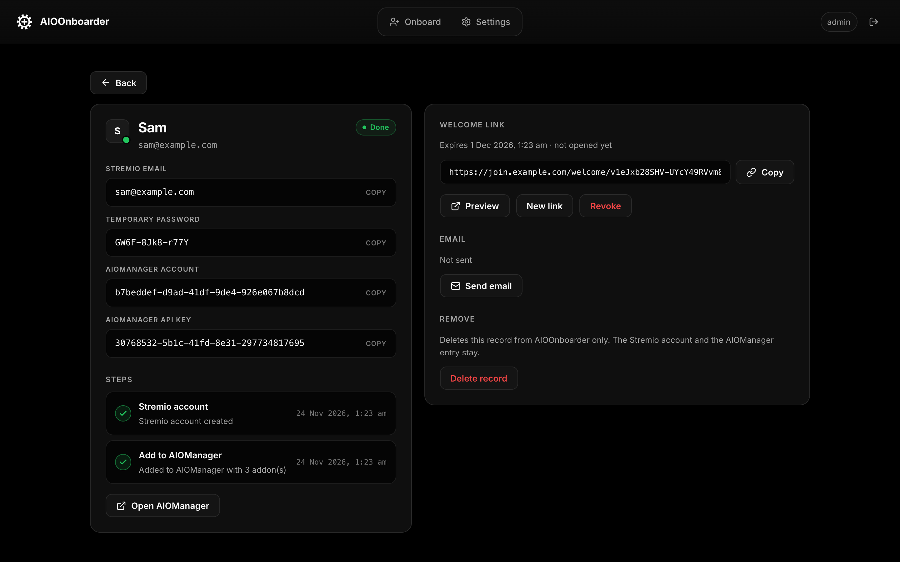
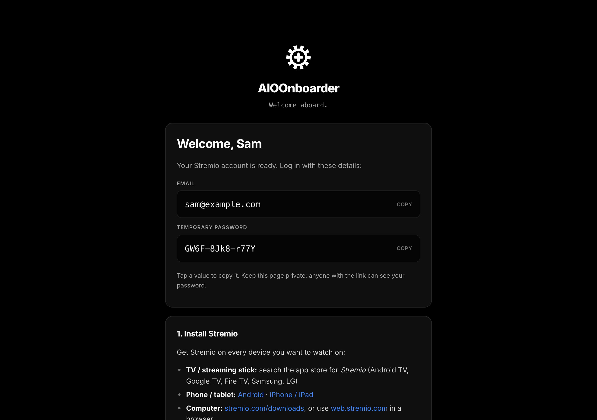
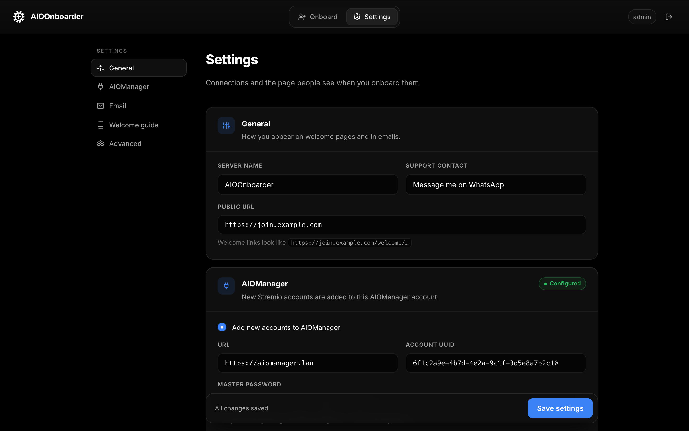
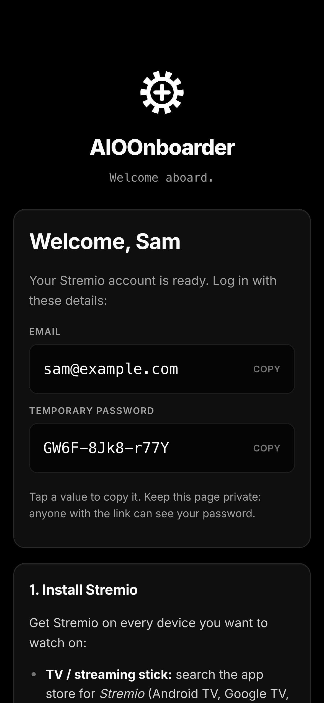

<p align="center">
  
</p>

<h1 align="center">AIOOnboarder</h1>

<p align="center"><code>One link to onboard them all.</code></p>

<p align="center">Onboarding for people you share a Stremio setup with, in the spirit of <a href="https://github.com/wizarrrr/wizarr">Wizarr</a>.</p>

<p align="center">
  
</p>

Enter someone's email, and AIOOnboarder:

1. **Creates a Stremio account** for that email with a readable temporary password (`Kx7m-Pq4r-Tz9w`).
2. **Adds it to [AIOManager](https://github.com/sonicx161/aiomanager)** with the Stremio auth key, so the account shows up there ready to have addons pushed to it.
3. **Hands them a welcome link** with their login and an onboarding guide, and/or **emails it to them**.

## Screenshots

| Onboard | Record |
|---|---|
|  |  |

| Welcome page (what they see) | Settings |
|---|---|
|  |  |

<p align="center"></p>

<sub>Screenshots use demo data against local stand-ins for Stremio and AIOManager.</sub>

## Features

- One-form onboarding with per-step status (Stremio / AIOManager / email) and **retry from the failed step** (it never creates a second Stremio account)
- Welcome page per user: email + temp password with tap-to-copy, plus your guide (Markdown, editable in Settings, with `{{name}}`, `{{email}}`, `{{server_name}}`, `{{support_contact}}` placeholders)
- Welcome links expire (default 7 days), can be revoked or re-issued, and show when they were first opened
- Optional SMTP email, with or without the password in the body (default: link only)
- AIOManager connection test before you save, and a preview of the welcome page from Settings
- Secrets at rest (AIOManager master password, SMTP password, temp passwords, Stremio auth keys) are AES-256-GCM encrypted
- Single admin account, scrypt-hashed, rate-limited login, SameSite=Strict session, strict CSP
- Dark UI that matches AIOManager's look, works on phones
- No build step, three runtime dependencies, SQLite via `node:sqlite`

## How the AIOManager integration works

AIOManager has no "add account" API: the web app keeps each manager's whole state as one client-side encrypted blob at `/api/sync/:uuid`. AIOOnboarder does what the AIOManager web app does when you click *Add account*:

- authenticates with `x-sync-password = sha256(masterPassword + ":sync-auth-token")`
- decrypts the blob (PBKDF2-SHA256 600k → AES-256-GCM, zlib when compressed)
- appends a Stremio account (plain auth key inside the blob, connection credentials encrypted with your vault key, an AIOManager API key, and the account's current addons)
- re-encrypts and pushes it back, preserving everything else

So AIOOnboarder needs your **AIOManager account UUID and master password**. They're stored encrypted on the AIOOnboarder host. Verified against AIOManager 2.0.1. If AIOManager changes its sync format, this is the part that will need updating: run the test connection after upgrades.

If you have AIOManager open in a browser while onboarding, it picks the new account up on its next sync (or refresh the page).

## Install

Needs Node.js 22.13+.

### Debian / Ubuntu / Proxmox LXC

```bash
curl -fsSL https://raw.githubusercontent.com/AshMT/aioonboarder/main/deploy/install.sh | bash
```

Installs Node 24 if needed, puts the app in `/opt/aioonboarder`, data in `/var/lib/aioonboarder`, and runs it as the `aioonboarder` systemd service on port 8080. Re-run the same command to update.

### Docker

```bash
docker compose up -d
```

### Manually

```bash
npm ci --omit=dev
npm start
```

Then open `http://<host>:8080`, create the admin account, and fill in **Settings**.

## Configuration

Everything is set in the web UI. Environment variables:

| Variable | Default | |
|---|---|---|
| `PORT` | `8080` | |
| `HOST` | `0.0.0.0` | |
| `DATA_DIR` | `./data` | SQLite database and the generated encryption key |
| `APP_SECRET` | generated into `DATA_DIR/app.secret` | Encryption key for stored secrets and sessions. Back it up with the database. |
| `TRUST_PROXY` | unset | The reverse proxy's address (e.g. `loopback,uniquelocal`), so HTTPS and client IPs are detected |

### AIOManager on a LAN-only HTTPS address

If AIOManager sits behind Caddy with `tls internal` (self-signed), either paste Caddy's root CA into **Custom CA certificate** in Settings, or tick **Allow self-signed TLS certificate**.

### Public address

Put AIOOnboarder behind a reverse proxy with HTTPS and set **Public URL** in Settings so welcome links use it. The bare domain opens the admin login, and `/welcome/<token>` is open to the people you onboard. Set `TRUST_PROXY` to the proxy's address (the installer defaults to private ranges) so login rate limits apply per client: 10 failed logins per IP, or 50 across all IPs, locks login for 15 minutes. A Caddy example:

```caddy
join.example.com {
	reverse_proxy 10.0.0.20:8080
}
```

To keep the admin UI on your LAN and publish only the welcome links, limit the proxy to `/welcome/*`, `/style.css`, `/app.js`, `/favicon.svg` and `/fonts/*`.

## Notes

- Stremio has no forced password change. The default guide sends people to stremio.com/reset-password to pick their own.
- Deleting a record in AIOOnboarder doesn't delete the Stremio account or the AIOManager entry.

## Development

```bash
npm install
npm run dev
npm test
```

## License

MIT. Bundles the [Inter](https://github.com/rsms/inter) font under the SIL Open Font License (`public/fonts/Inter-LICENSE.txt`). Not affiliated with AIOManager or Stremio.
